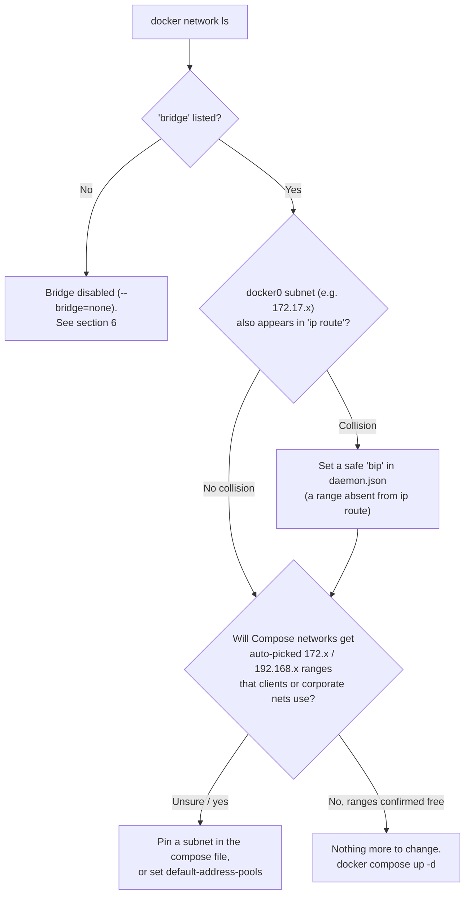

> **Docker series:** [1. Docker: A Practical Approach]({{ site.posts | where: "slug", "docker-a-practical-aproach" | first.url | relative_url }}) · [2. Deployment in Practice]({{ site.posts | where: "slug", "docker-deployment-in-practice" | first.url | relative_url }}) · [3. Networking Part 1: How a Request Reaches Your Container]({{ site.posts | where: "slug", "docker-networking-part-1" | first.url | relative_url }}) · **4. Networking Part 2**
{: .prompt-info}

[Part 1]({{ site.posts | where: "slug", "docker-networking-part-1" | first.url | relative_url }}) showed that a container gets its own IP from a bridge, a virtual switch on the host. This part asks the next questions: **which subnet** does that bridge use, **who picks it**, and what happens when it collides with your real network?

It comes from two real incidents on corporate servers, which share one foundation (how Docker hands out subnets):

- **Problem A: the default bridge is missing.** Builds fail with `network bridge not found`.
- **Problem B: a Docker subnet collides with the corporate network.** One `docker compose up` cuts the server off, SSH included.

The post starts with Problem B, the more dangerous one, then builds the foundation that explains both, then covers fixing, configuring, debugging and recovering.

<details>
<summary><strong>📑 Table of Contents</strong></summary>
<div markdown="1">

**The incident**
- [1. The problem in one paragraph](#1-the-problem-in-one-paragraph)

**How Docker picks subnets**
- [2. Two kinds of Docker networks](#2-two-kinds-of-docker-networks)
- [3. Docker's built-in address pool](#3-dockers-built-in-address-pool)
- [4. Which setting wins](#4-which-setting-wins)

**Deciding what to change**
- [5. Do I even need to touch `daemon.json`?](#5-do-i-even-need-to-touch-daemonjson)

**Problem A: the default bridge is missing**
- [6. Build fails: "network bridge not found"](#6-build-fails-network-bridge-not-found)
  - [systemd drop-ins](#systemd-drop-ins--why-there-seem-to-be-two-service-files)
  - [Fix A: build with host networking](#fix-a--build-with-host-networking-no-daemon-changes-safe)
  - [Fix B: re-enable a bridge on a safe subnet](#fix-b--re-enable-a-bridge-on-a-non-conflicting-subnet-daemon-change)
  - [Build-time vs. run-time network](#build-time-network-vs-run-time-network-two-separate-moments)
  - [Worked example](#worked-example--bridge-disabled-and-a-colliding-subnet)

**Problem B: preventing and fixing collisions**
- [7. Choosing a safe range](#7-choosing-a-safe-range)
- [8. Configuration](#8-configuration)
- [9. What to do when](#9-what-to-do-when)

**Tools and recovery**
- [10. Debug toolkit](#10-debug-toolkit)
- [11. Safe rollout with automatic rollback](#11-safe-rollout-with-automatic-rollback)
- [12. If you are already locked out](#12-if-you-are-already-locked-out)

</div>
</details>

---

## **1. The problem in one paragraph**

A server was reached over SSH from a client whose address was `172.17.33.5`. Running `docker compose up` on that server created a new Docker network, and Docker picked `172.17.0.0/16` for it. The server now had a local route saying *"all of 172.17.x.x is on this Docker bridge"*, so replies to the SSH client were sent into the empty bridge instead of out through the real gateway. The SSH session died with `client_loop: send disconnect: Broken pipe`, and port 22 stopped answering. The server itself was healthy the whole time. Only the route back to the client was hijacked.

```text
 BEFORE                                         AFTER docker compose up
 ──────                                         ───────────────────────
 reply to 172.17.33.5                            reply to 172.17.33.5
   → no specific route                             → matches 172.17.0.0/16 dev br-xxxx   (more specific)
   → default via <gateway> dev ens192  ✅          → sent into the empty Docker bridge  ❌
```

> Docker has no knowledge of your corporate network. It allocates subnets from private ranges that a company network may also use, and it does so **silently**.
{: .prompt-danger}

---

## **2. Two kinds of Docker networks**

Quick recap from [Part 1]({{ site.posts | where: "slug", "docker-networking-part-1" | first.url | relative_url }}#2-how-the-container-is-wired-to-the-host-the-bridge): a bridge is a **virtual switch** on the host that containers plug into; it's their gateway, and Docker NATs their traffic out through the host's real NIC. What Part 1 didn't cover is that there are **two kinds**. The **default** one is called `bridge` in `docker network ls`, and its interface is `docker0`. Each user-defined network gets its own bridge interface, named `br-<id>`.

| | Default bridge (`docker0`) | User-defined networks |
|---|---|---|
| Created by | Docker at startup | `docker compose up`, `docker network create` |
| Used by | `docker run` without `--network`, and image **build steps** (`RUN apt-get`, `RUN uv sync`, …) | Every Compose project (`<project>_default`) |
| Subnet controlled by | **`bip`** in `daemon.json` | Compose `ipam` subnet, else **`default-address-pools`**, else Docker's built-in pool |
| DNS by service name | No | Yes (`db:5432` works) |

**Why Compose doesn't just use `docker0`:** a per-project network gives isolation between projects and built-in DNS so services reach each other by name.

> **Why `bip` alone isn't enough:** it only moves `docker0`. Compose networks ignore it. Moving `docker0` away from `172.17` actually *frees* `172.17.0.0/16` for the first Compose network, which is exactly what caused the incident above.
{: .prompt-warning}

---

## **3. Docker's built-in address pool**

When nothing else is configured, Docker hands out subnets in this order:

- `172.17.0.0/16` … `172.31.0.0/16`, in **/16** blocks
- `192.168.0.0/16`, in **/20** blocks

It picks the next free block. "Free" means not used by another Docker network and not overlapping a route already on the host.

> **The blind spot:** a client reached through the **default gateway** has no specific route on the host, so Docker does not see it and happily takes its range. Checking `ip route` for collisions only protects networks that *have* a route.
{: .prompt-tip}

**Subnet size is a clue** to where a subnet came from, when reading `ip a` or `docker network inspect`:

| You see | It came from |
|---|---|
| `172.x.0.0/16` | Built-in pool (auto-picked) |
| `192.168.x.0/20` | Built-in pool (auto-picked) |
| `/24` or any other size | Explicitly pinned (compose file, `--subnet`) or your own pool |

Two servers running the *same* compose file can get *different* subnets, depending on what else was created on each over time. A server that "works fine" may simply have landed on a range no client uses. It is lucky, not protected.

---

## **4. Which setting wins**

| Situation | What Docker uses |
|---|---|
| Compose has `ipam: config: subnet: X` | Exactly `X`, whether or not a pool is configured, and even if `X` is outside the pool |
| Compose has no subnet, `daemon.json` has `default-address-pools` | The next free block from **your** pool |
| Neither | The next free block from Docker's **built-in** pool (`172.17`–`172.31`, then `192.168`) |
| `docker0` | Always `bip`, independent of both |

Rules that follow from this:

- **An explicit subnet is your responsibility.** Docker rejects overlap with another *Docker* network, but not with your corporate network.
- **Existing networks never move.** Changing a pool or a compose subnet only applies after the network is removed and recreated (`docker compose down`, then `up`).
- **Bridge subnets are local to each host.** Container traffic is NATed to the host's own IP before leaving, so two servers can safely use the same bridge subnet.
- **Your pool must not overlap subnets you pin explicitly**, or a pinned network can fail to create because the pool already handed that range out.

---

## **5. Do I even need to touch `daemon.json`?**

**Short answer: usually not for `docker0`, but think about Compose networks.** Bridge is Docker's default: on a normal host the `bridge` network already exists and `daemon.json` is empty or absent. You edit `daemon.json` to fix a problem (a subnet collision, a disabled bridge) or to make all future Compose networks safe, never as a requirement.

Run this **first**:
```bash
docker network ls                                   # is a 'bridge' row present?
docker network inspect bridge 2>/dev/null | grep -i subnet   # what subnet does it use?
ip route                                            # what subnets does the host already use?
echo $SSH_CONNECTION                                # where are YOU connecting from?
```



**The reasons to edit `daemon.json`:**
1. The default bridge subnet (`172.17.0.0/16`) **collides** with a corporate route you saw
   in `ip route` (e.g. `172.17.32.0/23`). → set a non-colliding `bip`.
2. The bridge was **disabled** with `--bridge=none`. → that lives in a systemd drop-in, not
   `daemon.json` (see [section 6](#6-build-fails-network-bridge-not-found)); you remove the flag AND set a safe `bip`.
3. You want **every future Compose network** on this server to come from a safe range. → `default-address-pools` (see [section 8](#8-configuration)).

> **Will a `bip` mess up the VM?** Not directly, *only* if you pick a subnet the host already routes.
> A `bip` touches **only** the host-local `docker0` bridge and container IPs. It does **not**
> touch the real NICs (`ens224`/`ens192`), corporate routes, nginx, SSH, or other machines.
> (Changing it does `systemctl restart docker`, which restarts all containers: brief downtime.)
>
> **But** moving `docker0` off `172.17` frees that range for the next Compose network ([section 2](#2-two-kinds-of-docker-networks)). Set a `bip` and handle Compose networks together.
{: .prompt-warning}

---

## **6. Build fails: "network bridge not found"**

### **Symptom**
```text
failed to solve: process "/bin/sh -c uv sync ..." did not complete successfully:
network bridge not found
```
The build dies at the first `RUN` step that needs the network (e.g. `uv sync`).

### **Why a build needs the default bridge**
Each `RUN` step in a build runs in a temporary container, and like any container it attaches to the default `bridge` (`docker0`, [section 2](#2-two-kinds-of-docker-networks)) unless told otherwise. This is how `uv sync` reaches the internal index. Docker normally creates `bridge` automatically on daemon start, so when it's missing, every build step that needs the network fails.

### **Diagnose**
```bash
docker network ls          # a healthy host has a 'bridge / bridge / local' row
```
If `bridge` is **missing** (only `host` and `none` present), check how the daemon starts:
```bash
systemctl status docker    # look at the ExecStart line
```
If you see `dockerd --bridge=none`, the default bridge was **deliberately disabled**
(usually because the default `172.17.0.0/16` subnet collided with corporate routing).
It is set in a systemd **drop-in**:
```bash
cat /etc/systemd/system/docker.service.d/override.conf
```

#### **systemd drop-ins — why there seem to be "two service files"**
`docker.service` is **one** service assembled from layers. `systemctl status docker` shows
both the base unit and its drop-ins:
```text
Loaded: loaded (/usr/lib/systemd/system/docker.service; ...)
Drop-In: /etc/systemd/system/docker.service.d
         └─http-proxy.conf, override.conf
```
- **Base unit** `/usr/lib/systemd/system/docker.service`: shipped by the **apt package**,
  overwritten on upgrades. Never edit it.
- **Drop-ins** `/etc/systemd/system/docker.service.d/*.conf`: **local admin** fragments that
  systemd merges **on top of** the base (applied alphabetically). They live under `/etc` so a
  package upgrade can't wipe them. This is the standard, correct way to customize a unit.

`ExecStart` is special: it can only hold one value, so a drop-in that changes it must first
**blank it** then re-set it. That's exactly what a typical `override.conf` does:
```ini
[Service]
ExecStart=                               # clears the base unit's ExecStart
ExecStart=/usr/bin/dockerd --bridge=none --host unix:///var/run/docker.sock --host tcp://0.0.0.0:2375
```
{: file="/etc/systemd/system/docker.service.d/override.conf"}

- `--bridge=none` → the flag that removes the default bridge (your problem).
- `--host tcp://0.0.0.0:2375` → exposes the **unauthenticated** Docker API on TCP 2375 (see
  [section 8](#8-configuration)). Often added by admins for remote `docker -H` access behind a firewall.
- A sibling `http-proxy.conf` drop-in usually just sets `HTTP_PROXY`/`HTTPS_PROXY`/`NO_PROXY`
  for dockerd so it can pull images through the corporate proxy. **Leave that one alone.**

To re-enable the bridge you edit **this drop-in** (remove `--bridge=none`), not the base unit.

> **Do NOT blindly re-enable the default bridge.** `dockerd --bridge=default` recreates `docker0` on `172.17.0.0/16`. If that overlaps an internal route (common with `172.x` corporate networks), it breaks outbound connectivity for the **whole host**: the classic "all docker services became unreachable" outage.
{: .prompt-danger}

### **Fix A — build with host networking (no daemon changes, safe)**
Borrows the host's working network for the build step only:
```bash
docker build --network=host \
  --build-arg BUILD_HTTPS_PROXY="$HTTPS_PROXY" \
  --build-arg BUILD_HTTP_PROXY="$HTTP_PROXY" \
  --build-arg BUILD_NO_PROXY="$NO_PROXY" \
  --build-arg APP_USER_ID="$(id -u)" \
  --build-arg APP_GROUP_ID="$(id -g)" \
  -t my-app:latest .
```
(The `BUILD_*` and `APP_*` args are explained in [Deployment in Practice]({{ site.posts | where: "slug", "docker-deployment-in-practice" | first.url | relative_url }}).)

For `docker compose build`, add under the service's `build:` key:
```yaml
build:
  network: host
```

> `--network=host` only fixes the **build**. Running the container via `docker compose up` still needs a network; if `bridge` is missing, add `network_mode: host` to the service or apply Fix B. (If you build with a `buildx` builder using the `docker-container` driver, host networking must also be allowed: `--allow network.host`.)
{: .prompt-info}

### **Fix B — re-enable a bridge on a NON-conflicting subnet (daemon change)**
1. Remove `--bridge=none` from the ExecStart line in
   `/etc/systemd/system/docker.service.d/override.conf`.
2. Set a safe subnet in `/etc/docker/daemon.json` (192.168.x avoids 172.x/10.x corp ranges):
   ```json
   {
     "bip": "192.168.200.1/24",
     "default-address-pools": [ { "base": "192.168.201.0/24", "size": 28 } ]
   }
   ```
   `bip` moves `docker0`; `default-address-pools` keeps future Compose networks off `172.x` too (see [section 2](#2-two-kinds-of-docker-networks)).
3. Reload + restart:
   ```bash
   sudo systemctl daemon-reload
   sudo systemctl restart docker
   docker network ls          # 'bridge' should reappear
   ```

> **`--bridge=none` and `bip` conflict.** `bip` only *configures* a bridge, it does not *create* one. With `--bridge=none` present, `bip` is ignored and no bridge exists. To get bridge mode you must **remove `--bridge=none` AND set a safe `bip`**. One alone is not enough.
{: .prompt-warning}

**Key facts:**
- Plain `docker build` and `docker compose build` have the **same** bridge dependency.
  Switching between them does **not** fix "network bridge not found".
- A daemon restart only recreates `bridge` if the daemon is **not** started with
  `--bridge=none`. Check `systemctl status docker` first.

### **Build-time network vs run-time network (two SEPARATE moments)**

This trips everyone up. A container's life has **two** networking moments, and fixing one
does **not** fix the other.

| Moment | When | Who needs network | How to give it network |
|---|---|---|---|
| **Build** | `docker build` / `compose build` | `RUN` steps, e.g. `uv sync` pulling packages | `--network=host` **flag**, or a working `bridge` |
| **Run** | `docker run` / `compose up` | your **app** doing `curl`, LLM API calls, hitting the proxy | `network_mode: host`, or a working `bridge` |

- **A failing build** means `uv sync` needs the internet and the `bridge` is gone.
  `--network=host` on `docker build` fixes just this.
- **Run is a different problem.** Once the image exists, there's no more `uv sync`. But the
  **running** container still needs network if the app makes outbound calls. If the host has
  no `bridge` and you did **not** set `network_mode: host`, the running container has
  **no way out**: every `curl` / API call inside it fails, even though the build succeeded.

So on a host where the default bridge is disabled (`--bridge=none`) you need **both**:
```bash
# BUILD
docker build --network=host ... -t my-app:latest .
```
```yaml
# RUN (compose service)
services:
  my-app:
    network_mode: host
```
…**or** fix the daemon's bridge once (Fix B above) and then you need neither.

What host mode changes for ports (`ports:` is ignored, the app's own port becomes the host port) is covered in [Part 1]({{ site.posts | where: "slug", "docker-networking-part-1" | first.url | relative_url }}).

### **Worked example — bridge disabled AND a colliding subnet**

On one deploy host, `ip route` showed the corporate net routes `172.17.32.0/23` + `172.17.34.0/23`, both inside Docker's default `172.17.0.0/16`. That's a **real collision**. All of `192.168.x` was free. Docker was also started with `--bridge=none`. The resolution that worked:
- removed `--bridge=none` from the systemd drop-in `override.conf`,
- set `"bip": "192.168.200.1/24"` in `/etc/docker/daemon.json`,
- `daemon-reload` + `restart docker` → `docker network ls` showed `bridge`, and
  `ip route` showed `192.168.200.0/24 dev docker0`. Then normal `docker compose up -d`.

> **The lesson that connects this to section 1:** `bip` fixed `docker0`, but the Compose project still gets its *own* network from the built-in pool. On this host the corporate `172.17.x` routes were visible in `ip route`, so Docker's route check ([section 3](#3-dockers-built-in-address-pool)) skips that range. On a host where the clients sit behind the default gateway, the same steps hand `172.17.0.0/16` to the first Compose network, and that is the SSH lockout from section 1. Always pair `bip` with a pinned compose subnet or `default-address-pools`.
{: .prompt-tip}

---

## **7. Choosing a safe range**

Private ranges are `10.0.0.0/8`, `172.16.0.0/12` and `192.168.0.0/16`. A subnet is safe if it overlaps none of:

- The host's own networks (check `ip a`, e.g. `10.20.36.0/23`, `10.20.38.0/23`)
- `docker0` (the `bip` range, e.g. `192.168.101.0/24`)
- Any address clients connect **from** (check `echo $SSH_CONNECTION`)
- Any network the host must reach: proxy, registry, lab devices, corporate ranges (e.g. `172.16.0.0/12`)
- Other subnets pinned on the same host

`192.168.x` is usually free on corporate `10.x`/`172.x` hosts. A `/24` = 256 addresses, gateway at `.1`: plenty for one host's containers. Confirm with the network team when unsure.

---

## **8. Configuration**

### **`/etc/docker/daemon.json` (server-wide)**

```json
{
    "bip": "192.168.101.1/24",
    "default-address-pools": [
        {"base": "192.168.192.0/20", "size": 24}
    ],
    "hosts": ["unix:///var/run/docker.sock", "tcp://0.0.0.0:2375"],
    "insecure-registries": ["10.20.38.13:5000"]
}
```
{: file="/etc/docker/daemon.json"}

You will often see a `daemon.json` like this on another server and be tempted to copy it. **Copy only the key you actually need.** Most keys are environment-specific.

| Key | Meaning | Copy it to another server? |
|---|---|---|
| `bip` | Address and subnet of `docker0`, overriding the default `172.17.0.0/16`. Keep it set explicitly. | Only with a subnet that's free in *that* server's `ip route` ([section 7](#7-choosing-a-safe-range)). |
| `default-address-pools` | Pool for every network created without an explicit subnet. `base` = the range, `size` = prefix length of each network handed out. `192.168.192.0/20` split into `/24` = 16 networks of ~250 addresses. | Yes, if the range is safe there. This is what protects future Compose projects. |
| `hosts` | Where the daemon listens. The Unix socket is what local `docker` / `docker compose` use and works by default. `tcp://0.0.0.0:2375` exposes the **unauthenticated, unencrypted** Docker API on every interface: root access for anyone who can reach port 2375. Only needed for remote clients such as CI; prefer TLS on 2376. Not required for running containers. | **No.** A known security hole; don't replicate without a deliberate, firewalled reason. |
| `insecure-registries` | Registries Docker may use over plain HTTP or with an untrusted certificate. Acceptable for internal registries on trusted networks. | Only if you actually pull from **that** registry. If you `docker load` your base image, no. |

> **Warning about `hosts`:** on a stock systemd install, `docker.service` already passes `-H fd://`. dockerd refuses to start when the same option is given both as a flag and in `daemon.json`, so setting `hosts` here as well makes it **fail to start**, unless a systemd drop-in (`override.conf`) replaces the start command. The reverse also applies: the `override.conf` in [section 6](#6-build-fails-network-bridge-not-found) already passes `--host` flags, so adding `hosts` to that server's `daemon.json` breaks it the same way. Never copy a `daemon.json` containing `hosts` to another server without checking this.
{: .prompt-danger}

**Applying a daemon change.** Restarting Docker stops every running container (those with a restart policy come back):

```bash
sudo dockerd --validate --config-file /etc/docker/daemon.json   # syntax + option check
sudo systemctl restart docker
docker info | grep -A5 -i "address pools"                        # confirm the pool is active
```

### **Compose — pin the project's subnet (per project, no daemon restart)**

At the top level of `docker-compose.yaml`, beside `services:`:

```yaml
networks:
  default:
    ipam:
      config:
        - subnet: 192.168.56.0/24
```
{: file="docker-compose.yaml"}

### **Compose — skip the project network entirely**

For a single service that doesn't need name-based DNS, join `docker0` instead. No new subnet is ever created; `ports:` mappings still work.

```yaml
services:
  myservice:
    network_mode: bridge
```
{: file="docker-compose.yaml"}

---

## **9. What to do when**

| Situation | Do this |
|---|---|
| New project on a shared server | Pin a subnet in the compose file, or use `network_mode: bridge` |
| You control the server and want all future projects safe | Add `default-address-pools` to `daemon.json` (plan a Docker restart) |
| Project already running on a risky range (e.g. `172.x`) | Pin a safe subnet, then `docker compose down && docker compose up -d` |
| Single service, no inter-service DNS needed | `network_mode: bridge` |
| Several services that talk by name | Pinned subnet |
| Build fails with "network bridge not found" | Check for `--bridge=none` ([section 6](#6-build-fails-network-bridge-not-found)); Fix A or Fix B |
| Build steps can't reach the internet | Check `docker0` exists and the proxy is passed as build args; last resort `build: network: host` |

---

## **10. Debug toolkit**


```bash
# Daemon config and active pools
cat /etc/docker/daemon.json
sudo dockerd --validate --config-file /etc/docker/daemon.json
docker info | grep -A5 -i "address pools"
systemctl status docker                # ExecStart line: --bridge=none? --host flags?

# Every Docker network and its subnet
docker network ls
docker network inspect -f '{{.Name}}  {{range .IPAM.Config}}{{.Subnet}}{{end}}' $(docker network ls -q)

# Host interfaces and routes (docker0 and br-xxxx are Docker bridges)
ip -br addr
ip route
ip route | grep -E '192\.168\.|172\.'

# Who is connecting, and how the host routes back to them
echo $SSH_CONNECTION                 # first field = client IP
ip route get <client-ip>             # must be "via <gateway> dev <real NIC>", never "dev br-..." or "dev docker0"

# What a compose file will actually create
docker compose config | grep -A4 ipam

# Container health
docker inspect --format '{{json .State.Health}}' <container> | python3 -m json.tool
```


> **Testing reachability:** `ping` uses ICMP, which is often filtered on corporate networks even when SSH and HTTPS work. A failed ping proves nothing. Test the real port instead:
{: .prompt-tip}

```bash
nc -vz <host> 22
ssh -vvv user@<host>
```

---

## **11. Safe rollout with automatic rollback**

Run from the same SSH path you care about (the one that would break):


```bash
cd <project-dir>
docker compose config | grep -A4 ipam                  # confirm the intended subnet

# Dead-man switch: tears the project down in 3 minutes unless cancelled.
# nohup keeps it alive even if SSH drops.
nohup sh -c 'sleep 180 && cd <project-dir> && docker compose down' > /tmp/rollback.log 2>&1 &
echo $!                                                 # note the PID

docker compose up -d
docker network inspect -f '{{range .IPAM.Config}}{{.Subnet}}{{end}}' <project>_default
ip route get <client-ip>                                # still via the gateway?

kill <PID>                                              # all good: cancel the rollback
```


If the session drops, wait 3 minutes. The network is removed and the route comes back on its own.

---

## **12. If you are already locked out**

1. You cannot fix it over the network: the route to you is the broken part.
2. Get in another way:
   - an out-of-band console (server BMC / remote management interface), or
   - a colleague with a session on the host, or from a host whose traffic isn't in the hijacked range (e.g. a machine on the same server subnet).
3. Run `docker compose down` in the project directory. This removes the network and its routes; SSH recovers immediately.
4. Fix the subnet ([section 8](#8-configuration)) **before** bringing it up again.

> **Reboot caveat:** a reboot clears the bad route, but a service with `restart: unless-stopped` comes back up and recreates the same network. Run `docker compose down` right after the reboot, or fix the subnet first.
{: .prompt-warning}
