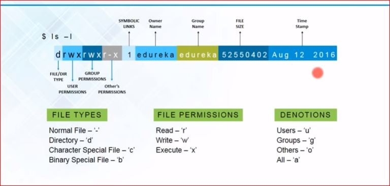
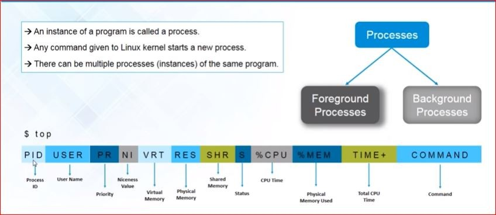
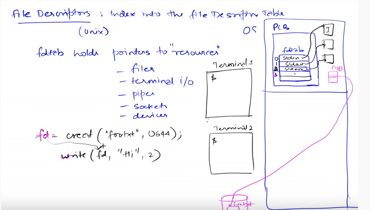

Here's a classic on-call moment. The disk is full. You find the culprit — a 5 GB application log — and delete it. Then you run `df`... **and the disk is still full.** The file is gone, `ls` can't see it, and the space never came back.

That mystery is solvable with exactly three ideas, and they happen to be the three ideas that explain half of Linux: **a file's name is not the file, a file's descriptor is not its name, and processes hold on to what they've opened.** Let's build them in order — every output below is from actually running it.

> **What we'll cover**
> 1. [The file is not its name: inodes](#inode)
> 2. [Two kinds of links](#links)
> 3. [Reading `ls -l` properly, at last](#ls)
> 4. [Processes in one breath](#processes)
> 5. [File descriptors](#fd) — and why `2>&1` suddenly makes sense
> 6. [The vanishing-disk-space mystery, solved](#deleted)
> 7. [Logrotate: the grown-up fix](#logrotate)
{: .prompt-info}

---

## **The file is not its name** {#inode}

When you create a file, Linux stores two separate things:

- the **inode** — a numbered record holding the file's metadata (size, owner, permissions, timestamps) and pointers to the actual data blocks on disk;
- a **directory entry** — the *name*, which is nothing more than a label pointing at that inode number.

```
"report.txt"  ──►  inode 286784  ──►  [data blocks on disk]
   (a name)        (the real file)
```

The inode doesn't know its own name. It doesn't contain the content either — it *points* to the content. `ls -i` shows the inode number, and `stat` shows the whole record:

```console
$ stat -c 'inode=%i links=%h size=%s perms=%A owner=%U' report.txt
inode=286784 links=1 size=6 perms=-rw-r--r-- owner=abhishek
```

`links=1` — exactly one name points at this inode so far. Let's change that.

---

## **Two kinds of links** {#links}

If a name is just a label on an inode, nothing stops **two names pointing at the same inode**. That's a **hard link**:

```console
$ echo "hello" > report.txt
$ ln  report.txt copy_name       # hard link
$ ln -s report.txt shortcut      # symbolic link
$ ls -li
286784 -rw-r--r-- 2 abhishek abhishek  6 Nov 11 04:41 copy_name
286784 -rw-r--r-- 2 abhishek abhishek  6 Nov 11 04:41 report.txt
286785 lrwxrwxrwx 1 abhishek abhishek 10 Nov 11 04:41 shortcut -> report.txt
```

Look at the first column. `report.txt` and `copy_name` share **inode 286784** — they are *the same file* wearing two name tags, and the `2` after the permissions counts exactly that. The **symbolic link** is different: it got its **own inode** (286785), because a symlink is a tiny real file whose content is just a *path*, a signpost pointing at a name.

Now delete the original:

```console
$ rm report.txt
$ cat copy_name
hello                                     # fine — the inode still has one name left
$ cat shortcut
cat: shortcut: No such file or directory  # the signpost points at nothing
```

`rm` doesn't delete files. It deletes **names** (the syscall is literally called `unlink`). The inode and its data are only reclaimed when the link count drops to zero — the hard link kept it alive, while the symlink dangled because the *name* it stored stopped existing.

> **Hard link:** another name on the same inode — survives deletion of the original.
> **Symlink:** a separate little file storing a path — breaks when the path dies, but can cross filesystems and point at directories.
{: .prompt-tip}

---

## **Reading `ls -l` properly, at last** {#ls}

With inodes and link counts in hand, every column of `ls -l` finally means something:

```
-  rw-  r--  r--   2   abhishek  abhishek   6   Nov 11 04:41   copy_name
│   │    │    │    │       │         │      │        │
│  user group others│    owner     group  size   modified
│   (r read, w write,└─ hard-link count (names on this inode)
│    x execute)
└─ type:  -  regular    d  directory   l  symlink
          c  char device (terminal)    b  block device (disk)
```

The same anatomy from an old slide in my notes, in colour:

{: width="700"}
_every column of `ls -l`, labelled_

Those last two types are worth a pause: your terminal (`/dev/pts/0`) and your disk (`/dev/sda`) appear in `ls -l` like any other file. Linux represents *devices as files* — remember that, it's about to matter.

(And the permission triplets read as user/group/others; `chmod`, `chown`, `chgrp` change them — `chmod u+x script.sh`, `chmod 770 dir/`. Enough for today.)

---

## **Processes in one breath** {#processes}

A **process** is a running instance of a program — every command you type starts one, several instances of the same program can run at once, and each gets a **PID** and remembers its parent's (**PPID**):

```console
$ pstree -p $$
bash(265821)─┬─head(265837)
             └─pstree(265836)
```

`ps -ef` lists them all; `top` shows them live. The kernel also *exposes* every process as — of course — files, in `/proc`:

```
/proc/265821/        one directory per PID
├── cmdline          what started it
├── status           state, memory, PPID
└── fd/              ← the door to the next section
```

Reading `top`'s columns, since they confuse everyone once: `PID` and `USER` you know; `PR`/`NI` priority and niceness; `VIRT` virtual memory, `RES` the part actually in RAM, `SHR` shared; `S` state; `%CPU`, `%MEM`, `TIME+` total CPU used; `COMMAND`. Or, as one picture from my notes:

{: width="740"}
_the `top` header, column by column_

---

## **File descriptors** {#fd}

When a process opens a file, the kernel notes it in a small **per-process table** and hands back the entry's index — a plain integer called a **file descriptor**. Every slot points at an opened resource, and thanks to "everything is a file", that resource can be a real file, a terminal, a pipe, a socket or a device.

This whiteboard sketch from my notes says it all — the per-process table (`fdtab`) holding pointers to resources, slots 0/1/2 pre-wired, and a freshly `creat()`-ed file landing in slot 3:

{: width="700"}
_the whole idea on one whiteboard_

Three slots exist before your program opens anything:

```
fd 0   stdin    where input comes from
fd 1   stdout   where normal output goes
fd 2   stderr   where errors go
```

Don't take my word — the table is visible in `/proc` (`$$` is the shell's own PID):

```console
$ ls -l /proc/$$/fd
0 -> /dev/pts/28        # keyboard — a terminal, which is a device file
1 -> /dev/pts/28        # screen
2 -> /dev/pts/28        # errors, also the screen
```

Open something and you simply get **the next free number**:

```pycon
>>> f = open("notes.txt", "w")
>>> f.fileno()
3
>>> g = open("notes.txt")       # same file again — new slot anyway
>>> g.fileno()
4
```

And here's a bonus that makes shell syntax click forever: redirection is just **rewiring this table**. `command > out.log` points fd 1 at a file instead of the terminal; `2>&1` means *"make fd 2 point wherever fd 1 currently points"*. It was fd arithmetic all along.

One more thing — the fd points at the **inode**, not at the name. You can feel where this is going.

---

## **The mystery, solved** {#deleted}

Let's reproduce the on-call story in miniature. A Python process writes ~100 MB to `huge.log` and keeps running; then we delete the file:

```console
$ du -h huge.log
96M     huge.log
$ rm huge.log
$ ls huge.log
ls: cannot access 'huge.log': No such file or directory
```

Gone? Ask the process:

```console
$ ls -l /proc/266123/fd
3 -> /scratch/fdlab/huge.log (deleted)
```

There it is. `rm` removed the *name*, but the process's fd 3 still holds the *inode*, so the kernel cannot reclaim the blocks. In my run, `df` reported the ~95 MB back **only after the process was killed**. An open fd keeps a file alive exactly like a hard link does — the inode's true reference count includes both names *and* open descriptors.

This is why "we deleted the logs but the disk is still full" ends with someone restarting the service — and why that restart "magically" works. To find such ghosts: `lsof | grep deleted`.

---

## **Logrotate: the grown-up fix** {#logrotate}

So how do you trim a log that a process holds open 24/7? You don't `rm` it — you use **logrotate**, which exists precisely because of everything above. It's not a daemon; cron runs it once a day:

```console
$ ls /etc/cron.daily/
apt-compat  dpkg  logrotate  man-db  ...
```

Global defaults live in `/etc/logrotate.conf`; each service drops its own policy into `/etc/logrotate.d/`. A real-world one, annotated:

```
/var/log/myapp/*.log {
    daily               # rotate every day
    rotate 30           # keep 30 old ones, delete beyond that
    maxage 365          # ...and nothing older than a year
    compress            # gzip rotated logs
    delaycompress       # but not the newest one (someone may still read it)
    dateext             # name them myapp.log-20260908 instead of .1 .2 .3
    notifempty          # skip empty logs
    missingok           # no error if the log vanished
    copytruncate        # ← the fd-aware part, see below
}
```

That last directive is our whole story in one word. Rotating by *renaming* would hit the mystery again — the process's fd follows the inode, so it would keep writing into the renamed file forever. Two honest ways out:

- **`copytruncate`** — copy the content to the rotated file, then truncate the original *in place*. Same inode, same fd, the process never notices. (Tiny window where lines written mid-copy are lost.)
- **rename + `postrotate` signal** — rename, then tell the process to reopen its log (e.g. `kill -USR1`, if the app supports it). No loss, needs cooperation.

Test a policy without waiting for cron — `-d` is a dry run, `-f` forces a real one:

```console
$ logrotate -d -s state myapp.rotate     # tells you what it *would* do
$ logrotate -f -s state myapp.rotate
$ ls app.log*
app.log  app.log.1                       # rotated, and app.log is back to 0 bytes
```

---

## **Summary** {#summary}

- A **name** is a directory entry pointing at an **inode**; the inode owns the metadata and data. `rm` only unlinks names.
- **Hard link** = second name, same inode (that's the count in `ls -l`). **Symlink** = its own tiny file holding a path; dangles when the path dies.
- A **process** is a running program instance; the kernel publishes each one under `/proc/PID/`.
- A **file descriptor** is an index into the process's table of open resources — files, terminals, pipes, sockets. `0/1/2` = stdin/stdout/stderr, and `2>&1` is just table rewiring.
- An open fd holds the inode alive: **deleting a busy log frees nothing** until the holder closes it (`/proc/PID/fd` shows `(deleted)`, `lsof | grep deleted` finds them).
- **logrotate** (via `/etc/cron.daily`, configs in `/etc/logrotate.d/`) rotates logs properly — `copytruncate` keeps the same inode so the writer never notices.
